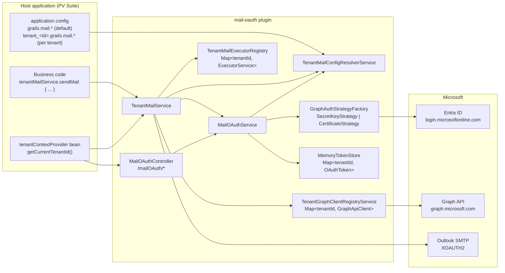
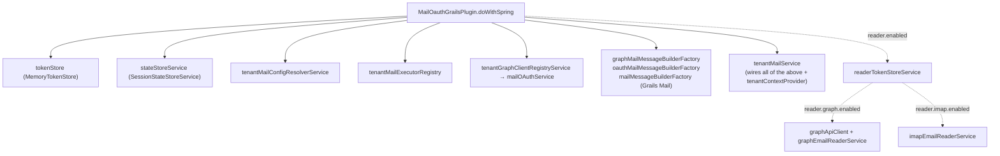
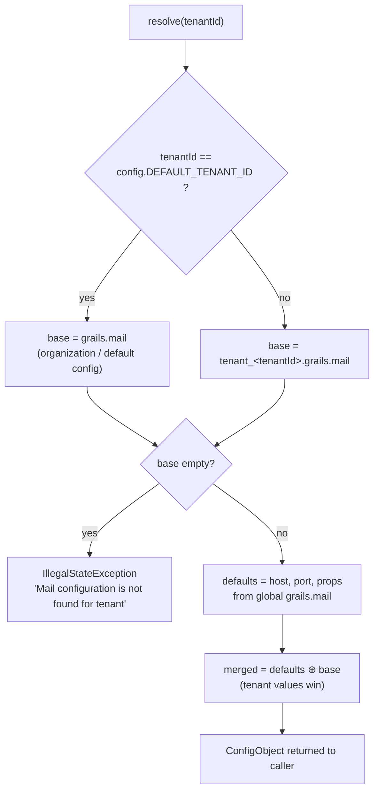
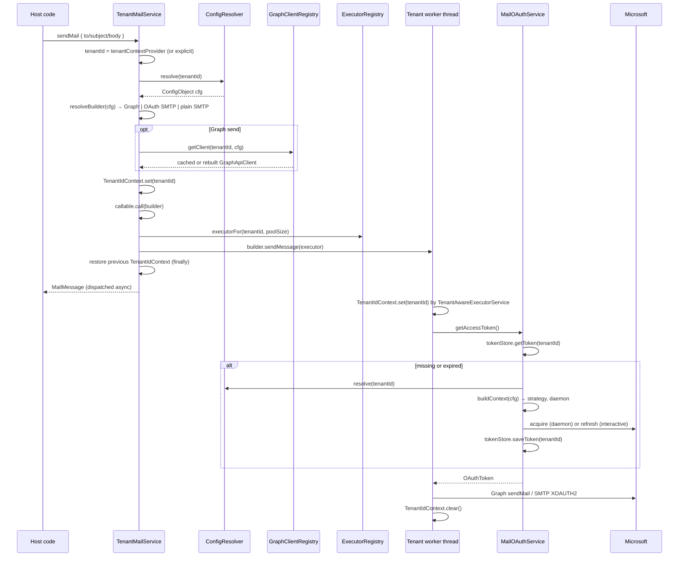
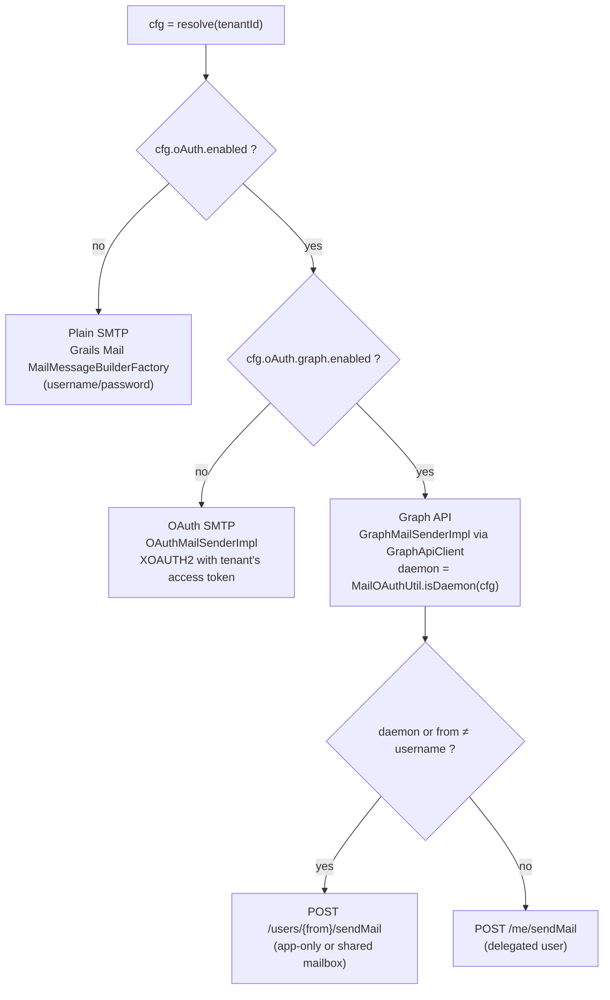
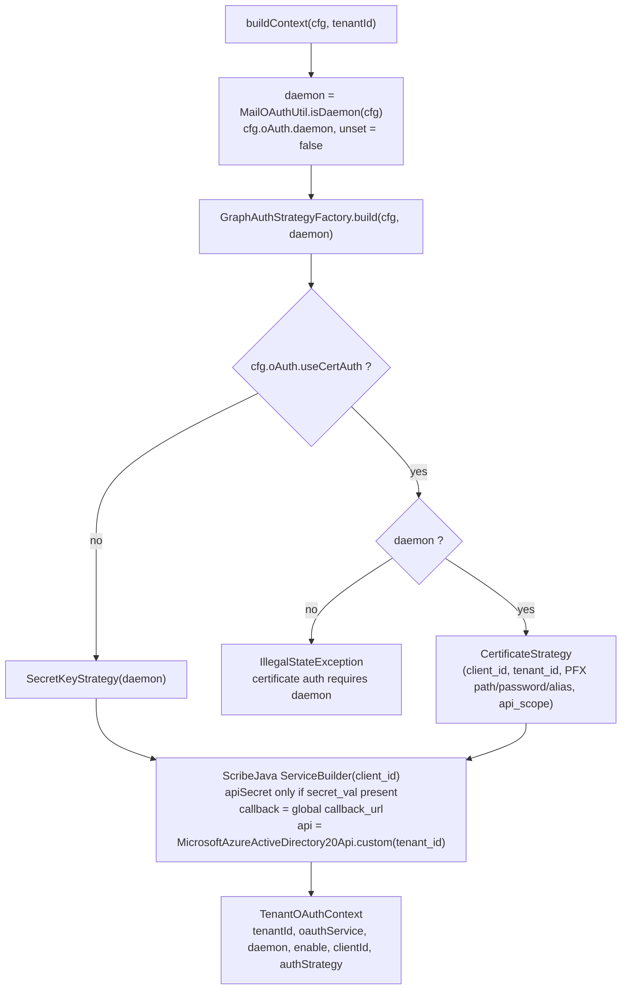
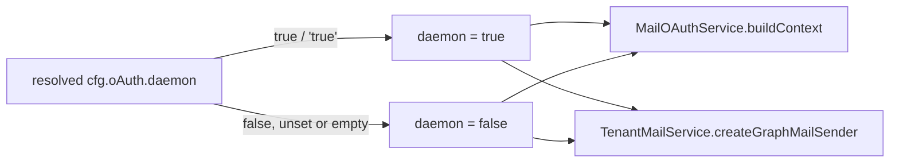
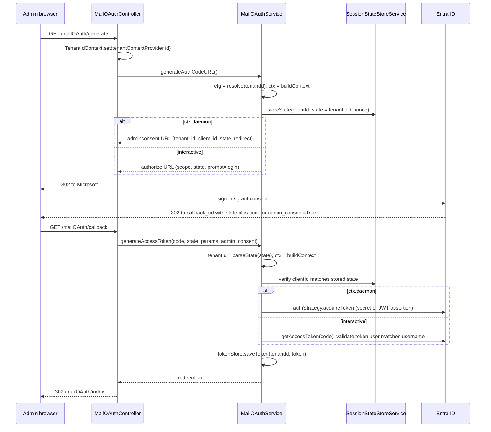
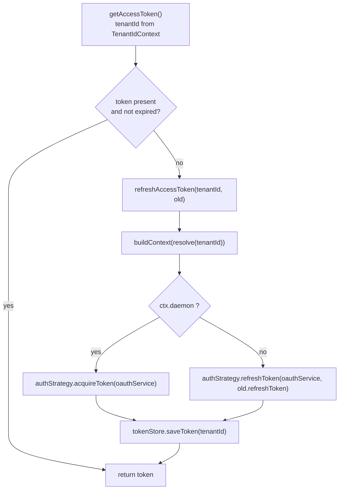
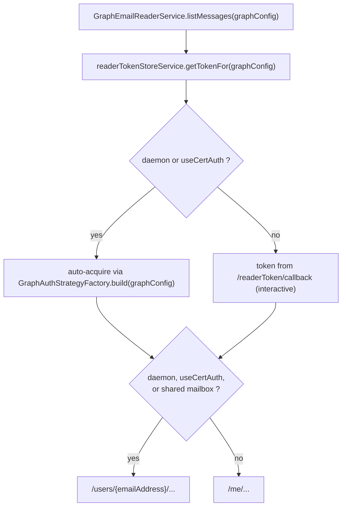

# mail-oauth Plugin Design

How the `mail-oauth` Grails plugin sends and reads mail through Microsoft OAuth, and how every
step is partitioned by tenant. This document is the end-to-end picture; the companion documents go
deeper on one topic each:

| Document | Covers |
|---|---|
| [`docs/MULTI_TENANCY.md`](MULTI_TENANCY.md) | Tenant context, config merge rules, per-tenant resources in detail |
| [`../SETUP_GUIDE.md`](../SETUP_GUIDE.md) | Azure app registration, certificate creation, consent, troubleshooting |
| [`../design_certificate.md`](../design_certificate.md) | Certificate (client-assertion) auth design and release notes |
| [`../README.md`](../README.md) | Full configuration property reference |

> **Two "tenant" ids.** The *application tenant id* is a `Long` identifying a customer/organization
> in the host application; everything in the plugin is keyed by it. `grails.mail.oAuth.tenant_id`
> is the *Microsoft Entra ID directory* id used when talking to Microsoft. "Tenant" below means the
> application tenant unless stated otherwise.

---

## 1. Big picture



Three things to hold on to:

1. **The plugin never decides the tenant.** The host supplies `tenantContextProvider`; the plugin
   carries the id into deeper layers through the `TenantIdContext` ThreadLocal.
2. **Config is resolved per call, per tenant.** Nothing about a tenant's mail setup is cached except
   its token, its Graph client, and its thread pool.
3. **Auth mode is per tenant.** Interactive vs daemon, and secret vs certificate, are decided from the
   tenant's resolved config on every token operation.

---

## 2. Startup: bean wiring

`MailOauthGrailsPlugin.doWithSpring` registers the beans below. Reader beans only exist when
`grails.mail.reader.enabled` is true.



`mailOAuthService` and `MailOAuthController` are Grails artefacts picked up by convention.
`tenantContextProvider` is **not** provided by the plugin; the application context fails to start
without it.

---

## 3. Which tenant, which config

### 3.1 Resolving the tenant id

| Entry point | How the tenant id is obtained |
|---|---|
| `tenantMailService.sendMail { }` | `tenantContextProvider.getCurrentTenantId()` |
| `tenantMailService.sendMailWithTenant(id) { }` | Explicit argument |
| `/mailOAuth/generate`, `refresh`, `revoke`, `tokenStatus` | `tenantContextProvider`, set on `TenantIdContext` for the request, cleared in `finally` |
| `/mailOAuth/callback` | Decoded from the OAuth `state` parameter (`MailOAuthUtil.parseState`) because the callback request has no session tenant |
| Token refresh during a send | `TenantIdContext.getTenantId()` on the worker thread (propagated by `TenantAwareExecutorService`) |

### 3.2 Default tenant vs specific tenant

`TenantMailConfigResolverService.resolve(tenantId)` picks the config tree and merges global
connection defaults underneath it.



Consequences:

- The **default tenant** is simply the tenant whose id equals `DEFAULT_TENANT_ID`; it uses the
  classic single-tenant `grails.mail` block unchanged. Existing deployments keep working.
- A **specific tenant** must have its own `tenant_<id>.grails.mail` block. Only `host`, `port` and
  `props` are inherited from the global block; `oAuth.*` is **not** inherited. In particular an
  unset `oAuth.daemon` on a tenant means `false` (see section 5.3).
- Static helpers in `MailOAuthUtil` (`callBackUrl`, `apiScope`, `redirectUri`, timeouts,
  `attachmentMax`) always read the **global** `grails.mail.oAuth` block. These are
  deployment-wide, not per tenant.

---

## 4. Send flow

### 4.1 Sequence



### 4.2 Sender selection



Each tenant can land on a different branch. The default tenant can be on plain SMTP while tenant 42
sends through Graph with a certificate.

---

## 5. Token lifecycle per tenant

### 5.1 Building the tenant OAuth context

Every token operation starts with `MailOAuthService.buildContext(cfg, tenantId)`:



### 5.2 Three modes, chosen per tenant

| Mode | Config | Consent step | First token | Renewal | Graph call |
|---|---|---|---|---|---|
| Interactive (delegated) | `daemon=false`, `secret_val` | User signs in via `/mailOAuth/generate` | Auth-code exchange in `/mailOAuth/callback` | `refresh_token` grant | `/me/sendMail` |
| Daemon, client secret | `daemon=true`, `secret_val` | Admin consent (URL from `/mailOAuth/generate`, or portal/CLI) | `client_credentials` grant | Re-acquire with `client_credentials` | `/users/{from}/sendMail` |
| Daemon, certificate | `daemon=true`, `useCertAuth=true`, `certificatePath` or `certificateBase64` | Admin consent (same as above) | `client_credentials` with signed JWT `client_assertion` | Re-sign JWT, re-acquire | `/users/{from}/sendMail` |

### 5.3 How `daemon` is resolved



There is no fallback from a tenant block to the global `grails.mail.oAuth.daemon`. The default
tenant resolves to the global `grails.mail` block itself, so for it `cfg.oAuth.daemon` *is* the
global value. Any other tenant must set `daemon = true` explicitly to run app-only.

### 5.4 Consent / authorization flow via the controller



If admin consent was granted outside the app (portal or CLI), the controller step is unnecessary for
daemon tenants: the first send finds no token, and `getAccessToken` → `refreshAccessToken` acquires
one lazily.

### 5.5 Refresh and revoke



`revokeToken()` clears the tenant's entry in `MemoryTokenStore` first, then best-effort revokes the
refresh and access tokens at Microsoft. For daemon tenants there is no refresh token, so revoke is
effectively a local clear.

---

## 6. Per-tenant isolation

| Resource | Owner | Key | Lifetime |
|---|---|---|---|
| OAuth token | `MemoryTokenStore` | `Long tenantId` | Until expiry/revoke; lost on restart |
| OAuth state | `SessionStateStoreService` | `clientId` | Until callback |
| Graph client | `TenantGraphClientRegistryService` | `tenantId` + signature of `enabled`, `graph.enabled`, `client_id`, `tenant_id` | Rebuilt under a per-tenant lock when the signature changes |
| Thread pool | `TenantMailExecutorRegistry` | `tenantId` | Created on first send with `poolSize` (default 5); idle threads time out; all shut down on context destroy |
| `TenantOAuthContext` / auth strategy | `MailOAuthService.buildContext` | none | Per call, never cached |
| Certificate keystore | `CertificateStrategy` | none | Re-read from `certificateBase64` or the file at `certificatePath` on every token acquisition (rotation without restart) |

A tenant's slow or failing mailbox cannot block another tenant's queue, and a token for tenant A is
never presented for tenant B because the tenant id travels with the task via
`TenantAwareExecutorService`.

---

## 7. Reader side (optional)

The reader is independent of sending and is driven by a `GraphConfig` object the caller builds
(`tenantId`, `graphTenantId`, `clientId`, `secretId` or certificate fields, `emailAddress`,
`daemon`, `isShared`).



---

## 8. Configuration shapes

**Single tenant / default only** (unchanged from earlier versions):

```groovy
DEFAULT_TENANT_ID = 1L
grails.mail.oAuth.enabled = true
grails.mail.oAuth.graph.enabled = true
grails.mail.oAuth.daemon = false
grails.mail.oAuth.client_id = '<app id>'
grails.mail.oAuth.secret_val = '<externalized secret>'
grails.mail.oAuth.tenant_id = '<entra directory id>'
grails.mail.oAuth.callback_url = 'https://host/mailOAuth/callback'
grails.mail.username = 'mailbox@company.com'
```

**Mixed tenants**:

```groovy
DEFAULT_TENANT_ID = 1L
grails.mail.oAuth.daemon = false                 // applies to tenant 1 (default) only

tenant_42.grails.mail.oAuth.enabled = true       // app-only with certificate
tenant_42.grails.mail.oAuth.graph.enabled = true
tenant_42.grails.mail.oAuth.daemon = true
tenant_42.grails.mail.oAuth.useCertAuth = true
tenant_42.grails.mail.oAuth.certificatePath = '/etc/app/tenant42.pfx'
tenant_42.grails.mail.oAuth.client_id = '<app id 42>'
tenant_42.grails.mail.oAuth.tenant_id = '<entra id 42>'
tenant_42.grails.mail.username = 'noreply@tenant42.com'

tenant_43.grails.mail.oAuth.enabled = true       // delegated with client secret
tenant_43.grails.mail.oAuth.graph.enabled = true
tenant_43.grails.mail.oAuth.client_id = '<app id 43>'
tenant_43.grails.mail.oAuth.secret_val = '<externalized secret 43>'
tenant_43.grails.mail.oAuth.tenant_id = '<entra id 43>'
tenant_43.grails.mail.username = 'support@tenant43.com'

tenant_44.grails.mail.host = 'smtp.tenant44.com' // plain SMTP, no oAuth block
tenant_44.grails.mail.username = 'app@tenant44.com'
tenant_44.grails.mail.password = '<externalized>'
```

Secrets and PFX passwords must come from environment or a vault, never from tracked files.

---

## 9. Known limitations

- Tokens, OAuth state and thread pools are in-memory: a multi-node deployment needs sticky routing
  for the consent callback, and every node acquires its own tokens.
- `callback_url`, `api_scope`, `redirect.uri`, Graph HTTP timeouts and `attachmentMax` are global,
  not per tenant.
- The Graph client cache signature ignores `daemon`, `useCertAuth` and certificate fields; this is
  harmless because the token credential and keystore are resolved on every call, but a signature
  change is the only thing that rebuilds the client.
- The interactive flow validates that the signed-in user matches `username`; daemon flows rely on
  `username`/`from` being a mailbox the application has `Mail.Send` rights on.
